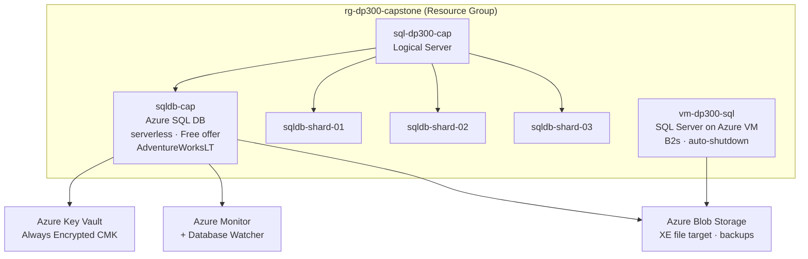

# dp300-hybrid-sql-platform


Hands-on build project for **DP-300 — Administering Microsoft Azure SQL Solutions**. A small, production-like hybrid SQL estate built from scratch, one module at a time, alongside each exam topic.

**Stack: T-SQL + Bicep + PowerShell/Azure CLI. No Python.** This is database administration — every artifact reflects what a DBA touches on the job.

---

## Architecture



Full component breakdown: [`docs/architecture.md`](docs/architecture.md)

---

## Skills Demonstrated

| Module | DP-300 Domain | Exam Weight | Key Skills |
|--------|--------------|------------|------------|
| [M1 — Deploy & Hybrid](modules/M1-deploy-hybrid/) | Plan & Implement Data Platform Resources | 15–20% | Bicep IaC, offering selection, serverless sizing, data compression |
| [M1B — Partition & Shard](modules/M1B-partition-shard/) | Plan & Implement Data Platform Resources | 15–20% | Table partitioning, partition elimination, SWITCH, Shard Map Manager, elastic queries |
| [M2 — Secure](modules/M2-secure/) | Implement a Secure Environment | 20–25% | Entra ID auth, TDE, Always Encrypted, firewall, DDM, RLS, ledger, auditing |
| [M3 — Monitor & Optimize](modules/M3-monitor-optimize/) | Monitor, Configure & Optimize Resources | 20–25% | DMVs, Query Store, Extended Events, blocking diagnosis, index tuning, DBCC, auto-tuning |
| [M4 — Automate](modules/M4-automate/) | Configure & Manage Automation of Tasks | 15–20% | SQL Agent jobs, Elastic Jobs across shards, Bicep redeploy, PowerShell/CLI automation |
| [M5 — HA/DR](modules/M5-hadr/) | Plan & Configure HA/DR | 20–25% | PITR, LTR, backup to URL, failover groups, geo-replication, log shipping, AG/FCI |

Full script-to-skill mapping: [`docs/skills-coverage.md`](docs/skills-coverage.md)

---

## Module Status

| Module | Status | Artifacts |
|--------|--------|-----------|
| M1 — Deploy & Hybrid | ⏳ Planned | — |
| M1B — Partition & Shard | ⏳ Planned | — |
| M2 — Secure | ⏳ Planned | — |
| M3 — Monitor & Optimize | 🔄 In Progress | `baseline-metrics.sql`, `cleanup-xe-sessions.sql` |
| M4 — Automate | ⏳ Planned | — |
| M5 — HA/DR | ⏳ Planned | — |

---

## How to Demo in an Interview

Connect to `sqldb-cap` via SSMS, then walk through these in order:

1. **Baseline monitoring** — run `M3/baseline-metrics.sql`. Explain the two-layer view: Azure Monitor (outside, platform metrics) vs DMVs (inside, engine-level). Explain the "outside-in" diagnostic workflow.
2. **Query Store** — open SSMS Object Explorer → `sqldb-cap` → Query Store → "Top Resource Consuming Queries". Walk through a regression scenario using the plan comparison view.
3. **Row-Level Security** — open `M2/rls-patient-doctor.sql`. Switch user context via `EXECUTE AS`. Show same `SELECT` returning different rows. Explain predicate function + security policy binding.
4. **Data compression** — run `M1B/data-compression.sql`. Show `sys.partitions` before/after; explain ROW vs PAGE tradeoffs.
5. **HA/DR decision** — open `M5/runbook-hadr-decision.md`. Walk through the RPO/RTO matrix: why Active Geo-Replication vs Failover Group vs Always On AG vs log shipping.

---

## Repo Layout

```
infrastructure/   Bicep IaC — deploys the full hybrid estate
modules/          T-SQL scripts + run-books, one folder per capstone module
  M1-deploy-hybrid/
  M1B-partition-shard/
  M2-secure/
  M3-monitor-optimize/
  M4-automate/
  M5-hadr/
scripts/          Cross-cutting PowerShell/CLI helpers (deploy.ps1, connect.ps1)
sample-data/      Data loading strategy — AdventureWorksLT + SalesPartitioned
docs/             Architecture, skills coverage, verification checklists
```

---

## Build Methodology

Each script is built live during the corresponding lesson — nothing is pre-written. Workflow per level:

```
Lesson → open modules/<M>/ → author script one statement at a time
→ run against live sqldb-cap → observe output → git commit → update trackers
```

Every `.sql` file opens with a standard header:

```sql
-- Module:    <M#>
-- Level:     <L##>
-- Sub-skill: <DP-300 exam sub-skill>
-- Mode:      HANDS-ON | FLOW-ONLY | HYBRID
-- Teardown:  <how to remove any paid resource, or "none">
```

Run-books (`.md`) use the same fields in a front-matter table. FLOW-ONLY artifacts narrate the full portal/CLI flow without provisioning paid resources.

---

## Quick Start

```powershell
# 1. Authenticate
az login

# 2. Deploy the estate
pwsh scripts/deploy.ps1

# 3. Connect
# SSMS: sql-dp300-cap.database.windows.net → sqldb-cap
# Or:
pwsh scripts/connect.ps1
```

Copy `.env.example` to `.env` and fill in your subscription ID and admin credentials before running.

---

## Cost Profile

| Resource | Cost model |
|----------|-----------|
| `sqldb-cap` (serverless, Free offer) | $0 — 100k vCore-sec/month free |
| `vm-dp300-sql` (B2s + auto-shutdown) | ~$0.05/hr when running — torn down same session |
| Shard databases, elastic-job agent DB | Short burst — torn down same session |
| Failover group / geo-replication secondary | Billed like a primary — torn down immediately after demo |
| Managed Instance, Always On AG / FCI | FLOW-ONLY — never provisioned |

Every paid resource is logged in the vault Cost Tracker before provisioning.
