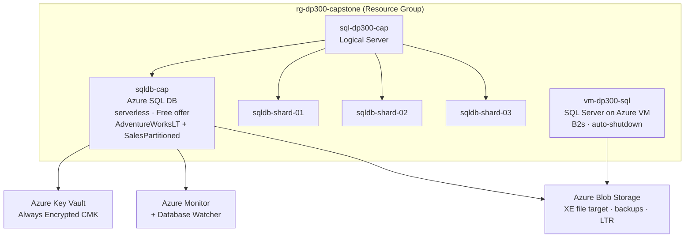

# Architecture — dp300-hybrid-sql-platform

A small, cost-controlled hybrid SQL estate that covers every DP-300 exam domain hands-on.

---

## Component Map

---

## Component Details

### sql-dp300-cap (Logical Server)

- Management container for all Azure SQL databases in the estate.
- Holds server-level firewall rules, Entra ID admin assignment, and login definitions.
- Does **not** represent a VM or compute — it is a control-plane object only.
- Exam domain: Domain 1 (Deploy) + Domain 2 (Security — firewall rules, Entra admin).

### sqldb-cap (Azure SQL Database)

- Service tier: **Serverless** on the **Free offer** (100k vCore-sec + 32 GB/month, no charge).
- Sample data: `AdventureWorksLT` schema; large `SalesPartitioned` table (~5–10M rows) for partitioning labs.
- Primary target for all monitoring, security, and optimization scripts.
- Exam domains: 1 (deploy/compress), 2 (security), 3 (monitor/optimize), 4 (automation via Elastic Jobs).

### sqldb-shard-01 / -02 / -03 (Shard Set)

- Three separate Azure SQL databases simulating horizontal sharding.
- Shard Map Manager (M1B module) routes queries by key range.
- Cross-shard elastic queries demonstrate the Elastic Database feature.
- **Cost**: Short burst — provisioned and torn down same session.
- Exam domain: Domain 1 (partitioning / sharding sub-skill).

### vm-dp300-sql (SQL Server on Azure VM)

- B2s VM with SQL Server Developer edition (free license) and auto-shutdown.
- Covers IaaS-specific tasks: SQL Server Agent jobs, backup to URL (Blob), log shipping, patching.
- Exam domain: Domain 1 (IaaS deploy), Domain 4 (SQL Agent), Domain 5 (HA/DR — backup, log shipping).
- **Cost**: ~$0.05/hr when running. Deallocated (not deleted) between sessions to preserve disk state.

### Azure Key Vault

- Stores the Column Master Key for Always Encrypted labs.
- Referenced in M2 (Always Encrypted setup runbook).
- Exam domain: Domain 2 (data at rest / in transit).

### Azure Monitor + Database Watcher

- **Azure Monitor**: platform-level metrics (CPU%, DTU%, IO%). Alert source. ~93 days retention.
- **Database Watcher**: managed service for centralized multi-database monitoring, long retention, ADX/Fabric backing store.
- Exam domain: Domain 3 (monitoring).

### Azure Blob Storage

- Used as the target for Extended Events file sessions on Azure SQL DB (PaaS has no local disk).
- Used for VM backups (`BACKUP DATABASE ... TO URL`) and Long-Term Retention.
- Exam domain: Domain 3 (XE), Domain 5 (HA/DR — backup/restore).

---

## Domain Coverage

| DP-300 Domain | Components Used |
|---------------|----------------|
| 1 — Plan & Implement (15–20%) | sql-dp300-cap, sqldb-cap, Bicep, shard set, vm-dp300-sql |
| 2 — Security (20–25%) | sqldb-cap (Entra auth, TDE, AE, DDM, RLS, ledger, auditing), Key Vault, firewall rules |
| 3 — Monitor & Optimize (20–25%) | sqldb-cap (DMVs, Query Store, XE), Azure Monitor, Database Watcher, Blob Storage |
| 4 — Automation (15–20%) | vm-dp300-sql (SQL Agent), sqldb-cap (Elastic Jobs), Bicep + PowerShell/CLI |
| 5 — HA/DR (20–25%) | sqldb-cap (PITR, LTR, failover group, geo-rep), vm-dp300-sql (backup to URL, log shipping), Blob Storage |

---

## Cost Profile

| Resource | Model | Notes |
|----------|-------|-------|
| `sqldb-cap` | $0 — Free offer | Always-on; never delete during cert |
| `vm-dp300-sql` | ~$0.05/hr running | Deallocated between sessions |
| Shard databases | Short burst | Created + deleted same session (M1B) |
| Elastic-job agent DB | Short burst | Created + deleted same session (M4) |
| Failover group secondary | Short burst | Created + deleted same session (M5) |
| Geo-replication secondary | Short burst | Created + deleted same session (M5) |
| Key Vault | ~$0.03/10k ops | Negligible for lab use |
| Blob Storage | ~$0.02/GB/month | Minimal (XE + backup files small) |
| Managed Instance | FLOW-ONLY | Never provisioned — too expensive |
| Always On AG (multi-node) | FLOW-ONLY | Never provisioned |
| FCI | FLOW-ONLY | Never provisioned |
